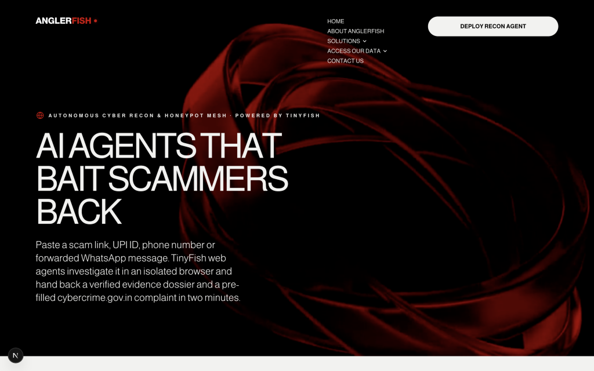
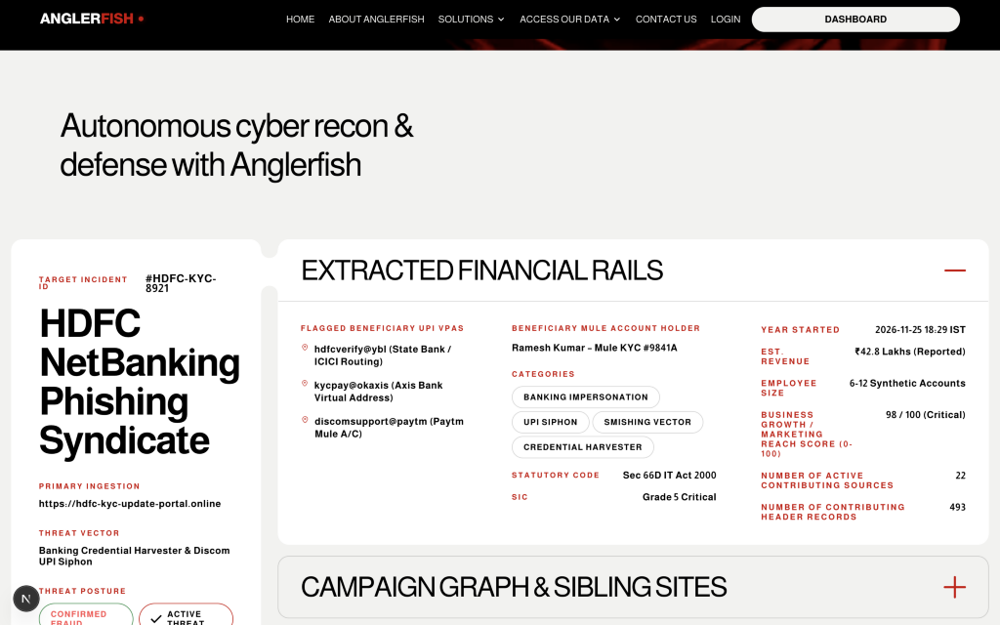
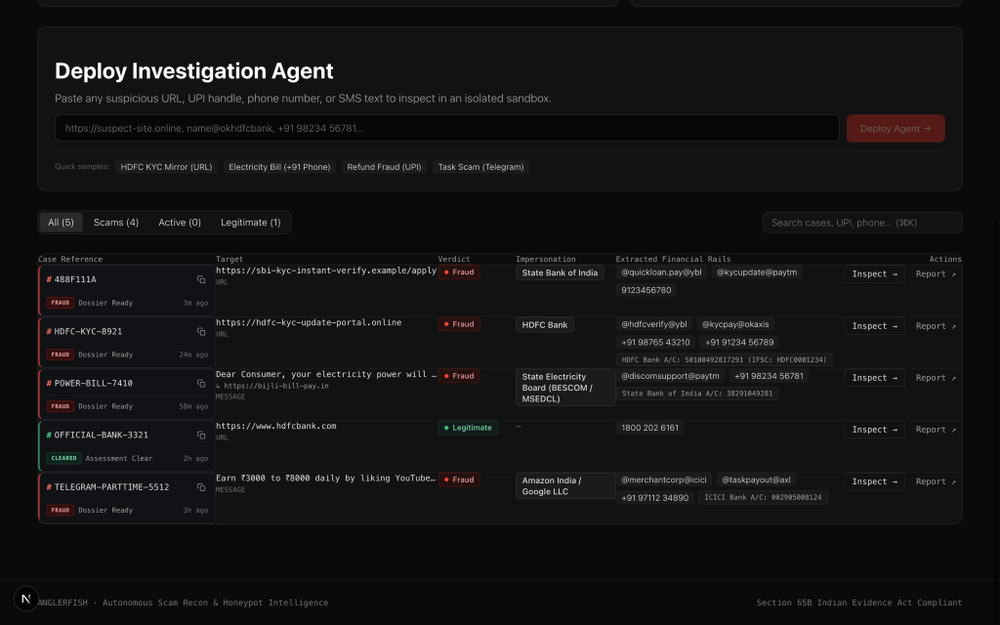
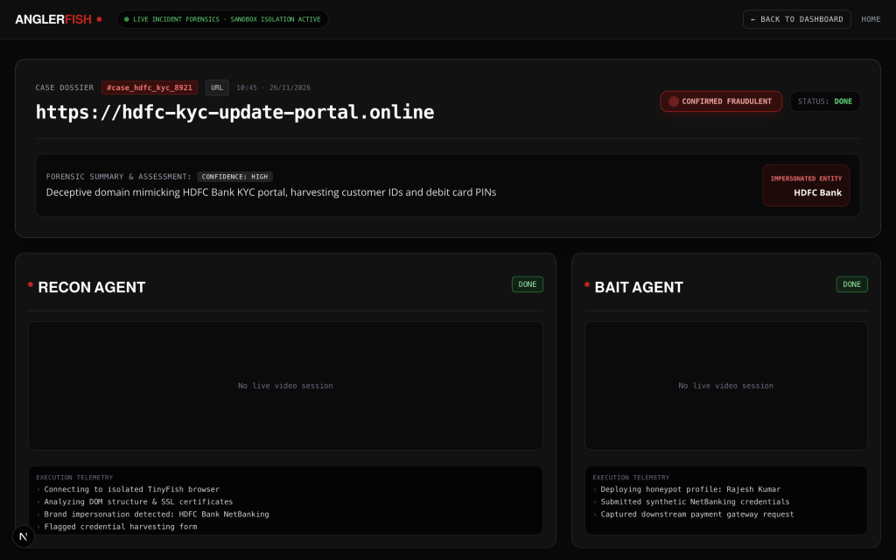
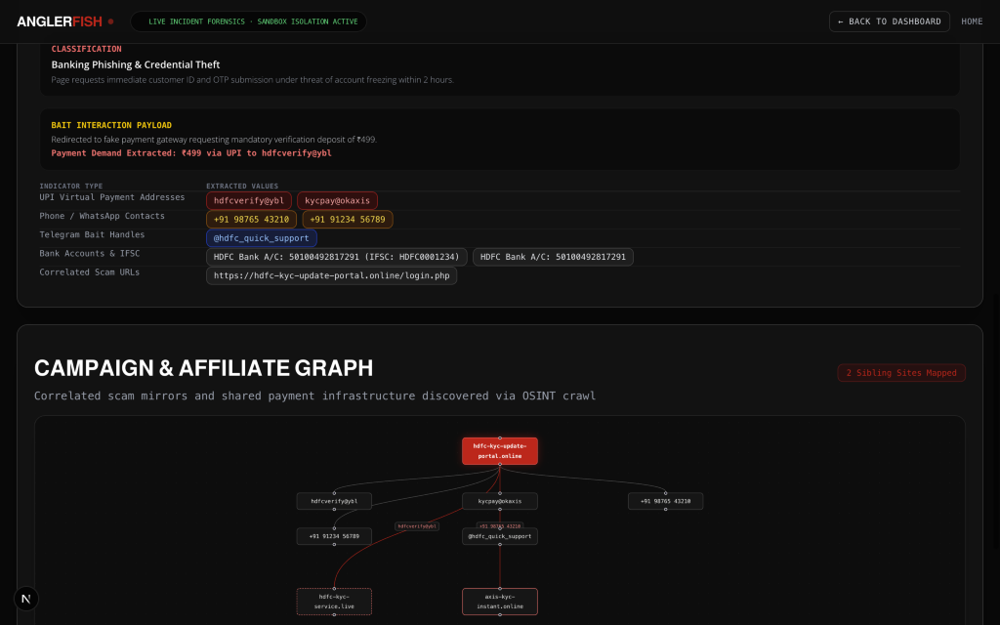
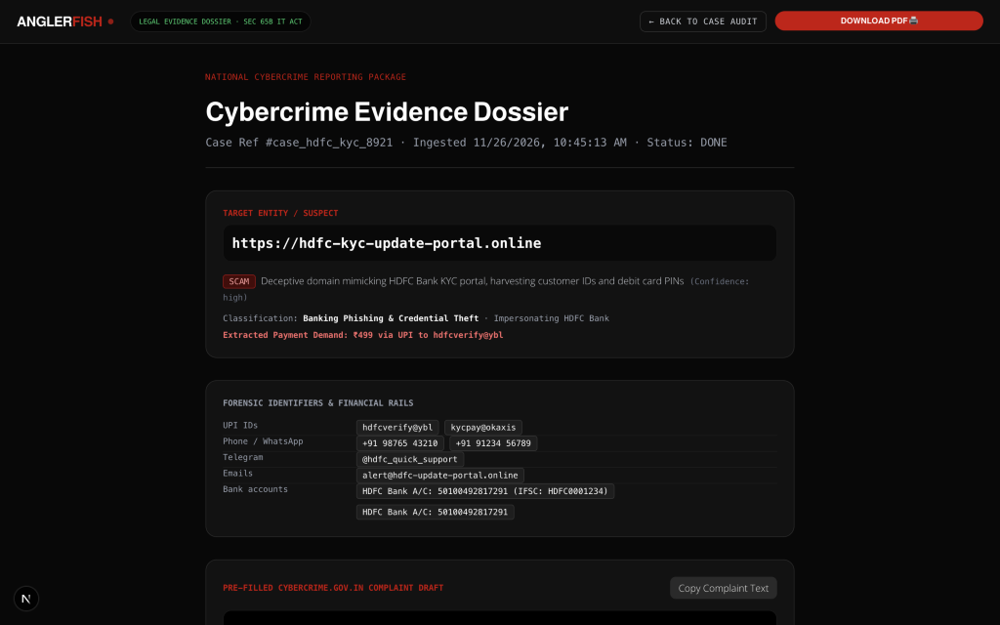

<div align="center">

# 🐟 OPENFISH

### Autonomous AI Agents That Bait Scammers Back

**Paste a scam link, UPI ID, phone number or forwarded WhatsApp message.**<br>
TinyFish autonomous web agents investigate it in an isolated browser sandbox, unmask hidden financial rails,<br>
and compile a court-admissible evidence dossier and pre-filled [cybercrime.gov.in](https://cybercrime.gov.in) complaint in under two minutes.

<br>

[](https://github.com/Yug-dev0/OpenFish/actions/workflows/ci.yml)
[](https://nextjs.org)
[](https://docs.tinyfish.ai)
[](https://www.typescriptlang.org)
[](https://tailwindcss.com)
[](./LICENSE)
[](https://cybercrime.gov.in)

<br>

<!-- Hero Preview / Rotating 3D Mesh Animation -->


<br><br>

<sub>Built with ⚡ by <b><a href="https://github.com/Yug-dev0">Yug Patel</a></b>.</sub>

</div>

<br>

---

## 📑 Table of Contents

- [The National Crisis & Problem](#-the-national-crisis--problem)
- [How OpenFish Works](#-how-openfish-works)
- [🎬 Live Video Demonstration](#-live-video-demonstration)
- [📸 Visual Showcase & Platform Tour](#-visual-showcase--platform-tour)
  - [1. 3D Cyber Defense Landing Page](#1-3d-cyber-defense-landing-page)
  - [2. Live Threat Dossier Snapshot](#2-live-threat-dossier-snapshot)
  - [3. National Operations & Telemetry Dashboard](#3-national-operations--telemetry-dashboard)
  - [4. Real-Time Autonomous Sandbox & Baiting Session](#4-real-time-autonomous-sandbox--baiting-session)
  - [5. Interactive Campaign & Affiliate Graph](#5-interactive-campaign--affiliate-graph)
  - [6. Section 65B Evidence Dossier & Complaint Generator](#6-section-65b-evidence-dossier--complaint-generator)
- [⚡ Quick Start](#-quick-start)
  - [Prerequisites](#prerequisites)
  - [Running with the Mock Server (Zero Key Required)](#running-with-the-mock-server-zero-key-required)
  - [Running Against Real TinyFish API Keys](#running-against-real-tinyfish-api-keys)
  - [Smoke Tests & CI Assertions](#smoke-tests--ci-assertions)
- [⚙️ Configuration Reference](#-configuration-reference)
- [🏗️ System Architecture & Data Flow](#-system-architecture--data-flow)
- [🛡️ Safety, Isolation & Ethics](#-safety-isolation--ethics)
- [⚖️ Statutory Compliance (Sec 65B & 66D IT Act)](#-statutory-compliance-sec-65b--66d-it-act)
- [📁 Project Structure](#-project-structure)
- [🗺️ Product Roadmap](#-product-roadmap)
- [👤 Author](#-author)
- [📄 License](#-license)

<br>

---

## 🚨 The National Crisis & Problem

Indians lost over **₹19,813 crore to cyber fraud in 2025 alone across 21.7 lakh registered complaints**. 

```
                                  THE ASYMMETRY OF CYBERCRIME
                                  
   Victim Receives Scam        Victim Blocks Number           Scam Ring Survives Unharmed
 ┌──────────────────────┐    ┌──────────────────────┐    ┌──────────────────────────────────┐
 │ SMS / WhatsApp / URL │───▶│ Individual blocks or │───▶│ Syndicate instantly spins up 50  │
 │ Phishing Bait        │    │ deletes message      │    │ new domains, virtual SIMs & VPAs │
 └──────────────────────┘    └──────────────────────┘    └──────────────────────────────────┘
                                                                        │
                                                                        ▼
 ┌──────────────────────────────────────────────────────────────────────────────────────────┐
 │  Filing actionable police reports or bank freeze notices requires forensic evidence:    │
 │  • Step-by-step browser recordings & screenshots                                         │
 │  • Real-time beneficiary payment rails (UPI VPAs, Mule Bank Accounts, IFSC codes)        │
 │  • Correlated domain mirror infrastructure & telecom sender MSISDNs                      │
 │                                                                                          │
 │  ⚠️ NO CITIZEN SHOULD EVER COLLECT EVIDENCE BY HAND FROM A HOSTILE, MALICIOUS SITE.      │
 └──────────────────────────────────────────────────────────────────────────────────────────┘
```

**OpenFish eliminates this asymmetry.** It operates autonomous web agents inside disposable remote browsers that safely engage scam operations, trigger backend payment requests to unmask illicit beneficiary rails, and compile tamper-evident court dossiers.

<br>

---

## 🧠 How OpenFish Works

OpenFish executes a 4-stage pipeline combining autonomous browser control, synthetic persona deception, and OSINT campaign mapping:

```
  ┌─────────────────────────────────────────────────────────────────────────────────────────────────┐
  │                                     OPENFISH PIPELINE                                         │
  └─────────────────────────────────────────────────────────────────────────────────────────────────┘
           │
           ▼
  ┌─────────────────┐       Opens hostile target in isolated TinyFish Chromium sandbox (Stealth).
  │ 1. RECON AGENT  │ ────▶ Analyzes DOM, SSL, DNS, and visual spoofing. Extracts visible handles.
  └─────────────────┘       Derives instant Verdict: SCAM | SUSPICIOUS | LEGITIMATE.
           │
           ├──────────────────────────────┐
           ▼ (if SCAM)                    ▼ (if LEGITIMATE)
  ┌─────────────────┐            ┌─────────────────┐
  │  2. BAIT AGENT  │            │ ASSESSMENT ONLY │
  └─────────────────┘            └─────────────────┘
  Fills deceptive forms with     Baiting & mapping are skipped.
  disposable synthetic personas. No synthetic data ever reaches
  Triggers hidden payment steps. a legitimate business.
  Unmasks mule UPIs & accounts.
           │
           ▼
  ┌─────────────────┐       TinyFish Search API queries every discovered identifier across the web.
  │ 3. MAPPER AGENT │ ────▶ TinyFish Fetch API verifies candidate pages and builds the campaign graph.
  └─────────────────┘       Exposes sibling phishing mirrors and shared infrastructure.
           │
           ▼
  ┌─────────────────┐       Auto-compiles SHA-256 sealed Section 65B forensic evidence package.
  │ 4. LEGAL REPORT │ ────▶ Generates pre-filled 14-field complaint for cybercrime.gov.in / 1930.
  └─────────────────┘       Exportable to court-ready PDF with complete audit trail.
```

| Stage | Agent | Technology | Operational Function |
|:-----:|:------|:-----------|:---------------------|
| **1** | **Recon** | TinyFish Remote Stealth Browser | Opens the URL in an isolated sandbox. Evaluates brand impersonation, records step-by-step screenshots, and extracts UPI VPAs, phone numbers, Telegram handles, and bank details. |
| **2** | **Bait** | Synthetic Persona Engine | *Gated strictly on scam verdict.* Injects believable synthetic victim profiles into deceptive KYC/loan/task forms to trigger hidden payment endpoints and unmask destination accounts. |
| **3** | **Mapper** | TinyFish Search & Fetch APIs | Keyed web search across all captured identifiers. Validates sibling mirrors sharing analytics tags, registrar blocks, or mule rails to map the entire criminal syndicate. |
| **4** | **Dossier** | Forensic Document Compiler | Compiles a court-admissible evidence package with cryptographic SHA-256 hashes, step screenshots, and a pre-filled 14-field national portal complaint ready for immediate police and bank dispatch. |

<br>

---

## 🎬 Live Video Demonstration

Watch the autonomous OpenFish mesh in action as it investigates an active banking phishing syndicate, triggers the hidden UPI payment rail via synthetic decoy baiting, and compiles the legal dossier:

<div align="center">

```html
<!-- Native HTML5 Video for GitHub and Web Browsers -->
```
<video src="public/videos/home-hero-video.mp4" width="850" controls="controls" poster="public/videos/home-hero-video-poster.jpg" style="border-radius: 12px; border: 1px solid rgba(255,255,255,0.15); box-shadow: 0 20px 40px rgba(0,0,0,0.6);">
  <source src="public/videos/home-hero-video.mp4" type="video/mp4">
  Your browser does not support the video tag.
</video>

<br>

> 🔗 **Direct Video Link:** [`public/videos/home-hero-video.mp4`](./public/videos/home-hero-video.mp4) &nbsp;|&nbsp; 🖼️ **Video Poster:** [`public/videos/home-hero-video-poster.jpg`](./public/videos/home-hero-video-poster.jpg)

</div>

<br>

---

## 📸 Visual Showcase & Platform Tour

### 1. 3D Cyber Defense Landing Page
> Dynamic Webflow-inspired interface featuring the continuous 3D rotating spherical cyber mesh, real-time threat telemetry statistics, and direct case launcher.

<div align="center">
  
</div>

<br>

### 2. Live Threat Dossier Snapshot
> Real-time forensic snapshot showcasing live case `#HDFC-KYC-8921`, unmasked beneficiary VPAs (`hdfcverify@ybl`, `kycpay@okaxis`), and 4 interactive accordion panels (Financial Rails, Campaign Graph, Evidence Custody, and Police Referral).

<div align="center">
  
</div>

<br>

### 3. National Operations & Telemetry Dashboard
> Dedicated cyber command console featuring the Honeypot Sandbox Dispatcher, 4 live aggregation metrics, segmented verdict filtering (`All`, `Scams`, `Active`, `Legit`), Cmd+K quick search, and tactical incident capsule cards with left threat posture stripes.

<div align="center">
  
</div>

<br>

### 4. Real-Time Autonomous Sandbox & Baiting Session
> Dual-stream investigation workspace. The left pane hosts the Recon Agent with live remote browser streaming iframe and step screenshots; the right pane displays the active Bait Agent injecting synthetic identities.

<div align="center">
  
</div>

<br>

### 5. Interactive Campaign & Affiliate Graph
> Powered by `@xyflow/react`, this interactive node-edge graph connects target URLs, extracted mule payment endpoints, telephone senders, and correlated sibling mirror domains into a unified syndicate map.

<div align="center">
  
</div>

<br>

### 6. Section 65B Evidence Dossier & Complaint Generator
> Court-admissible forensic dossier containing cryptographic SHA-256 hashes, unmasked financial rails, and an auto-generated 14-field complaint ready to copy or print for police and banking nodal officers.

<div align="center">
  
</div>

<br>

---

## ⚡ Quick Start

### Prerequisites
- **Node.js 18+** (Node 20 or 22 recommended)
- **npm** or **pnpm**
- **TinyFish API Key** (Optional for local testing; a scenario mock is bundled)

### Running with the Mock Server (Zero Key Required)
A full scenario-driven mock server of all three TinyFish APIs (`agent`, `search`, `fetch`) is included in `mock/tinyfish.mjs`.

```bash
# 1. Clone repository
git clone https://github.com/Yug-dev0/OpenFish.git
cd OpenFish

# 2. Install dependencies
npm install

# 3. Terminal 1: Start TinyFish Mock Server (port 4010)
npm run mock

# 4. Terminal 2: Start Next.js with mock configuration (port 3000)
npm run dev:mock
```

Open [http://localhost:3000](http://localhost:3000) to view the landing page, or [http://localhost:3000/dashboard](http://localhost:3000/dashboard) to dispatch investigations.

> **💡 Quick Testing Tips:**
> - Enter any URL containing `legit` (e.g. `https://mybank.com/legit`) → Recon clears the site, bait is safely skipped, and an assessment is generated.
> - Enter any URL containing `blocked` → Triggers the `SITE_BLOCKED` fail-open fallback.
> - Enter any other URL, phone (`+91 ...`), UPI (`...@okaxis`), or SMS text → Full scam reconnaissance, synthetic baiting, and legal complaint generation.

<br>

### Running Against Real TinyFish API Keys

```bash
# 1. Copy environment template
cp .env.example .env

# 2. Edit .env and insert your TinyFish key
TINYFISH_API_KEY=your_actual_api_key_here

# 3. Start development server
npm run dev
```

> **⚠️ Important:** Keep only one `.env` file. Next.js loads `.env.local` *over* `.env`. A placeholder in `.env.local` will shadow your real key and cause `401 INVALID_API_KEY` errors.

<br>

### Smoke Tests & CI Assertions

```bash
# Run automated end-to-end smoke verification across 5 diverse scam vectors
npm run smoke

# Run forensic unit test suite (12 verification assertions)
npm test

# Run in CI assertion mode (exits 1 on any forensic failure)
SMOKE_ASSERT=1 npm run smoke

# Test custom live inputs directly from CLI
node scripts/smoke.mjs "https://suspicious-pay.online" "refundfraud@okaxis"
```

<br>

### 📚 Extended Engineering & Compliance Documentation

- [📖 REST API Reference](./docs/API.md) — Comprehensive documentation of `/api/cases`, SSE streaming, and case export endpoints.
- [⚖️ Section 65B Forensics Specification](./docs/FORENSICS.md) — Cryptographic chain of custody, chronometer synchronization, and legal compliance.
- [🤝 Contributing Guidelines](./CONTRIBUTING.md) — Code quality standards, testing commands, and git workflow.
- [🛡️ Security Policy](./SECURITY.md) — Sandbox isolation guarantees and vulnerability reporting procedures.
- [📜 Changelog](./CHANGELOG.md) — Detailed version history and semantic releases.

<br>

---

## ⚙️ Configuration Reference

| Environment Variable | Default | Required | Purpose & Guidance |
|:---------------------|:-------:|:--------:|:-------------------|
| `TINYFISH_API_KEY` | — | **Yes** | Your TinyFish API authentication token. Set to `mock` when using the bundled scenario mock. |
| `TINYFISH_PROXY_COUNTRY` | `IN` | No | ISO country code for remote browser proxies. Indian cyber scam portals frequently geofence non-Indian IPs. |
| `TINYFISH_BROWSER_PROFILE` | `stealth` | No | `stealth` bypasses advanced anti-bot, Cloudflare Turnstile, and JS fingerprinting. `lite` is faster for simple portals. |
| `TINYFISH_AGENT_BASE` | `https://agent.tinyfish.ai/v1` | No | Remote browser agent endpoint. Point to `http://localhost:4010/v1` for local mock testing. |
| `TINYFISH_SEARCH_BASE` | `https://api.search.tinyfish.ai` | No | OSINT web search endpoint used by the Campaign Mapper. |
| `TINYFISH_FETCH_BASE` | `https://api.fetch.tinyfish.ai` | No | High-throughput web fetching endpoint to confirm sibling mirror signatures. |

<br>

---

## 🏗️ System Architecture & Data Flow

```
 CLIENT BROWSER                  NEXT.js APPLICATION SERVER                       TINYFISH INFRASTRUCTURE
 ──────────────                  ──────────────────────────                       ────────────────────────
       │                                     │                                                │
 [User / Citizen] ── POST /api/cases ───────▶│ createCase()                                   │
                                             │ ├─ Detect input type (URL, UPI, Phone, SMS)   │
                                             │ ├─ Store in memory Map (pub/sub)              │
                                             │ └─ Spawn detached runPipeline()                │
                                             │                                                │
 [Live View] ◀────── SSE /api/cases/:id/events (Real-time telemetry stream)                  │
       │                                     │                                                │
       │                                     ├─ 1. Recon Agent ──────────────────────────────▶│ POST /v1/automation/run-sse
       │                                     │    (Stealth profile, India proxy)              │ (Remote Chromium instance)
       │                                     │◀── SSE: started, streaming_url, screenshots ───┤
       │◀── Streaming Iframe ────────────────┤                                                │
       │                                     │    deriveVerdict() → SCAM | LEGIT | SUSPICIOUS │
       │                                     │                                                │
       │                                     │    (If LEGIT) ──▶ Stop. Generate assessment.   │
       │                                     │                                                │
       │                                     │    (If SCAM)                                   │
       │                                     ├─ 2. Bait Agent ───────────────────────────────▶│ POST /v1/automation/run-sse
       │                                     │    (Inject synthetic decoy persona)            │ (Trigger hidden payment rail)
       │                                     │◀── Extracted VPAs, Bank A/Cs, WhatsApps ───────┤
       │                                     │                                                │
       │                                     ├─ 3. Mapper Agent ─────────────────────────────▶│ GET /search?query="<VPA>"
       │                                     │    (Search live web for identifiers)           │ POST /fetch (Confirm mirrors)
       │                                     │◀── Sibling domains & affiliate graph ──────────┤
       │                                     │                                                │
       │                                     └─ 4. Compile Legal Dossier (Sec 65B Certificate)│
       │                                                                                      │
 [Legal Report] ◀── GET /case/:id/report (Section 65B certified evidence + printable complaint)│
```

<br>

---

## 🛡️ Safety, Isolation & Ethics

The safety and ethical posture of OpenFish is guaranteed by design at both the prompt and architectural levels:

1. **Strictly Passive Observation:** AI agents never attack, alter, reverse-exploit, DDoS, or disrupt any target system.
2. **Double-Blind Remote Isolation:** 100% of execution occurs inside TinyFish remote browser micro-VMs. Malicious JavaScript, drive-by downloads, or zero-day exploits cannot reach user or investigator devices.
3. **Synthetic Decoys Only:** Agents never use real citizen identities, personal bank accounts, actual debit/credit cards, or genuine OTPs.
4. **Legitimate Site Gating:** If the Recon agent determines a site is legitimate (e.g., official banking domain, valid SSL, non-fraudulent commercial store), baiting and campaign mapping are permanently blocked. No synthetic data reaches legitimate businesses.
5. **Private Key Management:** TinyFish API keys and backend tokens are strictly isolated on the server side. Screenshot images are proxied through an internal allow-listed route (`/api/screenshot`).
6. **Citizen-Controlled Submission:** OpenFish formats the complaint but does not automatically submit to government portals (which require OTP authorization), keeping humans in the loop.

<br>

---

## ⚖️ Statutory Compliance (Sec 65B & 66D IT Act)

Evidence collected from hostile websites frequently collapses in court due to broken chains of custody. OpenFish structures all investigative artifacts to meet Indian evidentiary requirements:

- **Section 65B Indian Evidence Act, 1872:**
  - Standardized electronic record certificate generated for all stored data.
  - SHA-256 cryptographic hashes for full DOM tree dumps and step-by-step screenshots.
  - Server timestamps recorded in coordinated UTC and Indian Standard Time (IST).
- **Section 66D Information Technology Act, 2000:**
  - Auto-categorizes offenses involving *cheating by personation using computer resources*.
  - Documents impersonated brand trademarks, spoofed domain WHOIS details, and fake security trust seals.
- **Pre-Formatted National Cyber Crime Portal ([cybercrime.gov.in](https://cybercrime.gov.in)) Complaint:**
  - 14 required fields automatically extracted and populated: Incident Category, Sub-Category, Suspect Website/App, Associated Mobile Numbers, Destination UPI VPAs, Bank IFSC & Account Numbers, Date/Time, and Summary Narrative.

<br>

---

## 📁 Project Structure

```
OpenFish/
├── app/                                 # Next.js 15 App Router
│   ├── page.tsx                         # 3D Cyber Defense Landing Page (excipio-html)
│   ├── dashboard/page.tsx               # Scam Operations & Threat Telemetry Dashboard
│   ├── login/page.tsx                   # Investigator & Citizen Authentication Portal
│   ├── case/[id]/                       # Real-Time Investigation Workspace
│   │   ├── page.tsx                     # Live streaming browser iframe & session monitors
│   │   └── report/page.tsx              # Court-admissible Section 65B legal evidence dossier
│   ├── solutions/page.tsx               # Comprehensive solutions suite overview
│   ├── identity-resolution/page.tsx     # Capability 01: Entity de-anonymization
│   ├── credit-risk/page.tsx             # Capability 02: Financial rail forensics
│   ├── kyb-verification/page.tsx        # Capability 03: Brand impersonation defense
│   ├── smb-intelligence/page.tsx        # Capability 04: Campaign & sibling mirror intelligence
│   ├── access-our-data/page.tsx         # Telemetry APIs & financial rail feeds
│   ├── snowflake-data-share/page.tsx    # Zero-ETL cloud data sharing architecture
│   ├── contact/page.tsx                 # Incident intake & investigator dispatch form
│   └── api/                             # Backend API Routes
│       ├── cases/route.ts               # Case creation & list endpoints
│       ├── cases/[id]/events/route.ts   # Real-time Server-Sent Events (SSE) telemetry
│       ├── cases/reset/route.ts         # Demo case registry reset
│       └── screenshot/route.ts          # Key-safe image proxy
├── components/                          # UI & Visualization Components
│   ├── SubpageLayout.tsx                # Enterprise subpage template
│   ├── CampaignGraph.tsx                # Interactive network graph (@xyflow/react)
│   ├── CaseView.tsx                     # Dual agent observation layout
│   └── StepGallery.tsx                  # High-resolution screenshot gallery
├── lib/                                 # Core Forensics & Pipeline Engine
│   ├── excipio-html.ts                  # Landing page markup & 3D hero video binding
│   ├── pipeline.ts                      # Input triage, orchestration & verdict derivation
│   ├── tinyfish.ts                      # TinyFish HTTP client (Agent SSE, Search, Fetch)
│   ├── prompts.ts                       # Safety preamble, agent goals & JSON schemas
│   ├── evidence.ts                      # Deduplication & identifier aggregation
│   ├── complaint.ts                     # Section 65B compliant legal narrative generator
│   └── store.ts                         # In-memory case registry with pub/sub
├── mock/                                # Scenario-driven TinyFish mock server
│   └── tinyfish.mjs                     # Offline fake of all 3 TinyFish APIs (:4010)
├── public/                              # Static Assets
│   ├── videos/                          # 3D hero demonstration video (MP4 + poster)
│   ├── images/                          # Brand logos & high-res assets
│   └── styles.css                       # Landing page animation stylesheets
├── docs/screenshots/                    # Documentation & README visual assets
│   ├── hero.png                         # 3D landing page hero
│   ├── dossier_snapshot.png             # Live dossier snapshot card
│   ├── dashboard.png                    # Operations & telemetry dashboard
│   ├── case.png                         # Live investigation view
│   ├── campaign_graph.png               # Interactive syndicate graph
│   ├── report.png                       # Legal complaint & evidence report
│   └── demo.gif                         # Animated cyber defense mesh loop
├── scripts/                             # Utility & Automation Scripts
│   ├── smoke.mjs                        # End-to-end smoke test runner
│   └── screenshots.mjs                  # Headless screenshot generator
├── Dockerfile                           # Production container specification
├── render.yaml                          # Infrastructure-as-code for Render deployment
└── ARCHITECTURE.md                      # Detailed technical architecture specification
```

<br>

---

## 🗺️ Product Roadmap

- [x] **v0.1 — Core Autonomous Engine:** Remote browser recon, synthetic decoy baiting, financial rail extraction, and Section 65B legal dossier compilation.
- [x] **v0.2 — Command Dashboard & Brand Experience:** Webflow-inspired 3D landing page, dedicated Operations Console, sample target dispatchers, and live metrics telemetry.
- [ ] **v0.3 — Citizen WhatsApp / Telegram Bot:** Forward suspicious messages directly to an OpenFish WhatsApp bot; receive verified dossiers and pre-filled complaints back in chat.
- [ ] **v0.4 — Direct Banking & Cyber Cell Ingestion Feeds:** Real-time webhook feeds of unmasked UPI VPAs and fraudulent account numbers pushed directly to bank fraud desks and NPCI freeze systems.
- [ ] **v0.5 — Multilingual Indian Dialects:** Expand synthetic bait personas across Hindi, Bengali, Tamil, Telugu, and Marathi to engage regional telecom smishing syndicates.

<br>

---

## 👤 Author

- **Yug Patel** — [@Yug-dev0](https://github.com/Yug-dev0)

<br>

---

## 📄 License

This project is licensed under the **MIT License** — see the [LICENSE](./LICENSE) file for details.

<br>

<div align="center">
  <sub>🛡️ Defending citizens and financial institutions from cyber fraud through autonomous AI intelligence.</sub>
</div>
